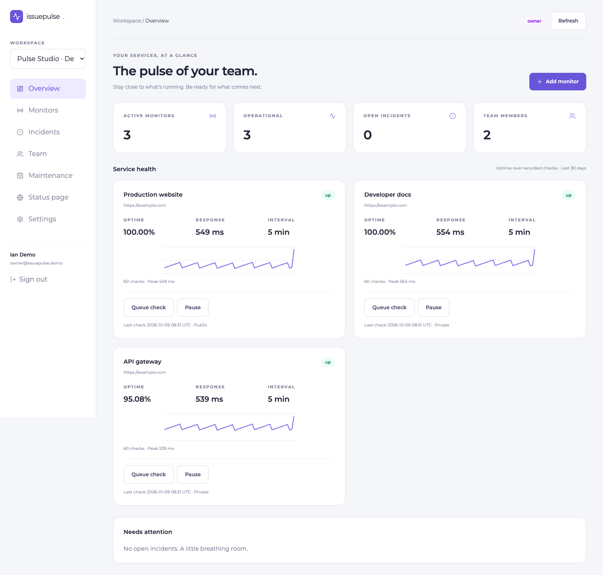

# IssuePulse

A team workspace for website monitoring, incident response, and public status pages. Built with Next.js, React, Tailwind CSS, Node.js, PostgreSQL, and Better Auth. Montserrat is bundled locally.

## Working features

- Registration, email verification, login/logout, seven-day sessions, reset, password changes, profile settings, and email-confirmed account deletion.
- Team onboarding and switching; owner/admin/member permissions; expiring, email-bound invitations and member administration.
- Public HTTP(S) monitors with configurable intervals, pause/resume, queued checks, sampled uptime, and response-time charts.
- Assigned incidents with investigation, identification, monitoring, and resolution updates.
- Maintenance windows that suppress downtime/recovery email alerts while checks continue.
- Explicitly published status pages, public/private monitors and incidents, incident history.
- Protected scheduler endpoint and standalone worker; database leases prevent concurrent duplicate check claims; durable, retried alert delivery.



## Local setup

Use Node.js 22 and PostgreSQL. Create a separate database for this project.

```sh
npm ci
cp .env.example .env.local
# Fill in DATABASE_URL, BETTER_AUTH_URL, BETTER_AUTH_SECRET, and CRON_SECRET.
npm run db:migrate
npm run dev -- --port 3002
```

Set `BETTER_AUTH_URL=http://localhost:3002`. Development emails are printed in the server terminal when SMTP is unset. Production requires working SMTP. Google sign-in is optional; configure its client ID/secret and callback URL `/api/auth/callback/google` to enable it.

Run the scheduler in a separate terminal:

```sh
npm run worker
```

Or run one batch with `npm run checks:run`. Each batch claims up to 10 due monitors. Check intervals describe when a monitor becomes due; actual timing depends on the scheduler. Requests time out after 10 seconds and DNS resolution after 5 seconds. HTTP 200–399 is considered up, and redirects are not followed. Charts show the latest 60 checks; uptime is the percentage of recorded checks that succeeded in the last 30 days, not time-weighted availability. History older than 30 days is removed by the worker.

## Demo data

Set a private `DEMO_PASSWORD` of at least 12 characters and run `npm run seed:demo`. This creates `owner@issuepulse.demo` and `member@issuepulse.demo` with a demo team, sample monitors, synthetic check history, and a resolved sample incident. Existing accounts/passwords and existing demo monitors are retained. The seed does not send real verification mail. Never add real data to a team shared through public demo credentials.

## Checks

Tests require a separate database whose name ends in `_test`. Migrate it before testing.

```sh
DATABASE_URL=postgresql://localhost:5432/issuepulse_test npm run db:migrate
DATABASE_URL=postgresql://localhost:5432/issuepulse_test npm test
npm run lint
npm run typecheck
npm run build
```

CI runs these checks against PostgreSQL. Authentication tests cover verification, sessions, reset, account deletion, rate limiting, and organization isolation. Monitoring tests cover private-network rejection, cross-team resources, owner/admin enforcement, incident transitions, and maintenance validation.

## Deployment

No public deployment is provisioned yet. Import this repository into Vercel using Next.js and Node 22, and create a separate Neon database. Set the environment variables from `.env.example`; use the actual production domain for `BETTER_AUTH_URL` without a trailing slash. Run `npm run db:migrate` with the production connection string before enabling signup, build, and deploy. Gmail SMTP uses `smtp.gmail.com`, port `587`, and an app password from the sending account. Store all credentials in the host's environment settings, never in Git.

Vercel Hobby's built-in cron is limited to once daily. Frequent monitoring needs an external scheduler that calls `GET /api/jobs/checks` with `Authorization: Bearer <CRON_SECRET>`, or an always-running Node worker. Invoke approximately every minute for short intervals. The endpoint rejects absent or incorrect credentials. No external scheduler or Google OAuth client has been provisioned or verified. This release supports 20 monitors per team, handles 10 per batch, and retries alert delivery up to five attempts. Free host/database/email quotas still apply.

## Architecture

See [architecture notes](docs/architecture.md). This is a portfolio release rather than a geographically distributed monitoring system: probes originate from the worker's hosting region and status data can be stale when the scheduler is stopped. Failed notification delivery is retained in `alert_outbox`; operational inspection currently requires database access. Incident updates are published explicitly; downtime does not silently create or close incidents.

## Screenshots

Desktop and mobile captures are in [docs/screenshots](docs/screenshots). Run `npm run preview:shots` against the seeded local app to refresh them. Install Playwright Chromium (`npx playwright install chromium`) or set `PLAYWRIGHT_BROWSER_PATH` to a supported local browser executable. Browser checks exercise owner/member visibility, dashboard tabs, public privacy, font, and mobile overflow.

### Free demo scheduler

The `Scheduled monitor checks` GitHub workflow runs about every 15 minutes, with manual dispatch available. Set the repository variable `ISSUEPULSE_URL` to the production HTTPS origin and repository secret `ISSUEPULSE_CRON_SECRET` to the same value as Vercel’s `CRON_SECRET`. This cadence gives the free database idle time between batches. The worker checks due monitors; intervals shorter than the scheduler cadence do not result in more frequent checks. GitHub schedules can be delayed, and public-repository schedules are disabled after 60 days without repository activity. This is suitable for the portfolio demo, not a precise availability SLA. See [GitHub scheduling documentation](https://docs.github.com/en/actions/reference/workflows-and-actions/events-that-trigger-workflows#schedule).
